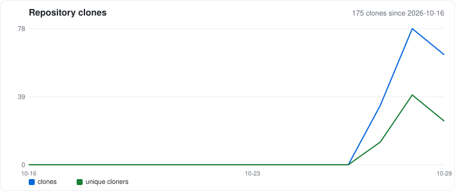

# registration-relay-selfhost

A ready-to-run, self-hosted registration relay, initially copied from
[Beeper's registration-relay](https://github.com/beeper/registration-relay),
the server behind `registration-relay.beeper.com`.

It's meant as a drop-in replacement for Beeper's public relay: anything that
works with it should work here by changing the relay address.

This repo packages the relay so it installs with one command, with its Go
dependencies vendored so builds don't depend on outside sources.

## Why there's a routing filter

The relay forwards every `/api/v1/bridge/<command>` request to the connected
device. Registration providers implement two commands: `get-version-info` and
`get-validation-data`. If a client sends any other command, the device ignores
it and the relay:

1. waits 60 seconds for an answer that never comes,
2. holds up that device's other requests meanwhile, then
3. drops the device's connection to force a reconnect.

Some clients send other commands periodically. Beeper's hosted relay answers
them with an instant, empty `401`, and those clients carry on.

`deploy/nginx.conf` does the same: the two provider commands and the device
connection pass straight through, and any other bridge command gets an
instant empty `401`. Everything else goes to the relay as-is.

## Requirements

- A Linux machine or VM that stays on, with Docker and Docker Compose (Intel or ARM)
- A permanent public HTTPS address. Either works, and neither needs open ports:
  - **Cloudflare Tunnel (recommended).** Free, but requires a domain you own,
    added to Cloudflare. If you don't have one, Cloudflare sells domains at
    cost, about $10/year for a `.com`.
  - **Tailscale Funnel.** Free, no domain needed. You get an address like
    `https://myserver.tail1234.ts.net`. Only the server runs Tailscale; phones
    and apps connect to it like any other website.
- A registration provider that lets you set a custom relay URL

The address must never change: devices and clients store it, and if it
changes, registration renewals fail. That's why temporary addresses such as
Cloudflare's `trycloudflare.com` quick tunnels won't work.

## Install

**1. Get the files**
```bash
git clone https://github.com/mkitchingh/registration-relay-selfhost.git
cd registration-relay-selfhost/deploy
cp .env.example .env && chmod 600 .env
```

**2. Create a secret.** Put the output in `.env` as `REGISTRATION_RELAY_SECRET=`:
```bash
openssl rand -base64 32
```
Back it up somewhere safe. It lets your device keep its relay code across
restarts; if it's lost or changed, every device gets a new code and must
register again.

**3. Set up the public address**, either A or B.

**A. Cloudflare Tunnel (recommended)**

Cloudflare dashboard → Zero Trust → Networks → Tunnels → Create a tunnel →
Cloudflared.
- Copy only the token (the long `eyJ...` string) into `.env` as `TUNNEL_TOKEN=`.
  Don't run the install commands Cloudflare shows.
- Add a route: **Published application**, a subdomain of your choice
  (e.g. `relay.example.com`), service type **HTTP**, URL **`rr-filter:8080`**.
- Leave `COMPOSE_PROFILES=cloudflare` in `.env`.

Then start it:
```bash
docker compose up -d
```
Your relay address is `https://relay.example.com`.

**B. Tailscale Funnel**

Tailscale runs as a container in this stack; nothing to install on the server.

> This option is less tested than Cloudflare. If something doesn't work,
> please open an issue.

In the [Tailscale admin console](https://login.tailscale.com/admin):
- **DNS** page: make sure **MagicDNS** is on, and turn on **HTTPS Certificates**.
- **Access controls** page: the policy must allow Funnel. New tailnets
  include this by default; if yours doesn't, add:
  ```json
  "nodeAttrs": [{ "target": ["autogroup:member"], "attr": ["funnel"] }]
  ```
- **Settings → Keys → Generate auth key.** Leave Reusable and Ephemeral off.
  Copy the key (`tskey-auth-...`).

In `.env`:
- `COMPOSE_PROFILES=tailscale`
- `TS_AUTHKEY=` the key you copied
- `TS_HOSTNAME=relay` (or another name; it becomes part of your address)

Then start it:
```bash
docker compose up -d
docker compose logs tailscale | grep -i -E "funnel|https://"
```
Your relay address is `https://relay.<your-tailnet>.ts.net`. You can also find
it on the **Machines** page of the admin console.

**Important:** on the **Machines** page, open the new `relay` machine's menu
(**…**) and choose **Disable key expiry**. Otherwise Tailscale signs it out
after about six months and your relay address stops working.

Already run Tailscale directly on the server? Set `COMPOSE_PROFILES=` (empty)
instead, open a local port (see [Using your own reverse proxy](#using-your-own-reverse-proxy-instead)),
start the stack, and publish it with
`sudo tailscale funnel --bg http://127.0.0.1:8080`.

**4. Check it** (replace with your address):
```bash
curl -s -o /dev/null -w '%{http_code}\n' https://relay.example.com/health                         # 204
curl -s -o /dev/null -w '%{http_code}\n' -X POST https://relay.example.com/api/v1/bridge/sign-data  # 401
```

## Point your devices and apps at it

Two different things connect to the relay, and they're set up differently:

- **Registration provider** — the Mac/iOS app that holds the Apple identity.
  Set its custom relay URL to `wss://relay.example.com/api/v1/provider`
  (`wss://`, ends in `/api/v1/provider`). Once connected, it shows a
  **registration code**.
  If you set `PROVIDER_SECRET` (see [Access](#access)), the provider uses the
  secret path instead: `wss://relay.example.com/<secret>/api/v1/provider`.
- **Client** — the bridge (e.g. OpenBubbles). Wherever you'd enter Beeper's
  relay address, use the **base address** `https://relay.example.com`
  (`https://`, no path) together with the registration code from the provider.
  The client **never uses `PROVIDER_SECRET`** — only the provider does.

So the secret and the code are different things: the secret is the provider's
key to register, and the code is what links a client to that provider. Moving
from Beeper's relay to yours issues a new code, so each client registers once
more.

## Access

By default, like Beeper's relay, this relay is open: anyone who knows your
address can connect a provider to it, and anyone who knows a device's code can
request its validation data. Codes are random, so in practice someone would
need both your address and a code.

### Approved providers only (optional)

Set `PROVIDER_SECRET` to lock it down. The provider endpoint then moves to
`/<secret>/api/v1/provider`, and the bare `/api/v1/provider` returns `404`.
Because a client can't get a code without a provider, gating the provider locks
the whole relay — and **only the provider URL changes; clients are untouched.**

From `deploy/`, this one command generates a secret (letters and digits, 12
characters — plenty, since the only attack is slow online guessing), writes it
to `.env`, prints it, applies it, and shows the result:

```bash
SECRET=$(openssl rand -hex 6) && sed -i '/^PROVIDER_SECRET=/d' .env && echo "PROVIDER_SECRET=$SECRET" >> .env && echo ">>> SAVE THIS SECRET: $SECRET" && docker compose up -d && sleep 2 && docker compose logs filter | grep provider-path
```

**Save the printed secret** — you'll need it for the provider URL. The log line
should read `provider-path: locked`. Then point your provider at:

```
wss://relay.example.com/<secret>/api/v1/provider
```

The secret rides inside the HTTPS request, so the path is encrypted in transit.
It's a shared secret in the URL, not per-user accounts — right-sized for a
personal or small-group relay. To reopen the relay, blank `PROVIDER_SECRET` in
`.env` (or delete the line) and run `docker compose up -d` again.

## Updating

```bash
cd registration-relay-selfhost && git pull
cd deploy && docker compose pull && docker compose up -d
```

## Using your own reverse proxy instead

By default the stack opens no ports on the server. To reach it from a reverse
proxy on the same machine:

```bash
cp compose.override.example.yml compose.override.yml
```

Set `COMPOSE_PROFILES=` (empty) in `.env`, run `docker compose up -d`, and
point your HTTPS reverse proxy, with websocket support, at `127.0.0.1:8080`.
If 8080 is already in use, change the first `8080` in `compose.override.yml`.

## Troubleshooting

```bash
docker compose ps                 # relay (healthy), filter, and cloudflared or tailscale: all Up
docker compose logs -f relay      # device connects, commands, errors
docker compose logs -f filter     # every request and its status code
```
- `404` on a command: no device is connected with that code. Check the
  provider shows connected, and that it's pointed at your relay, not Beeper's.
- Device keeps getting new codes: the secret changed. Restore it from your backup.
- Tailscale address not answering: check `docker compose logs tailscale`.
  "invalid key" means the auth key expired before first use; generate a new
  one. If it stopped after an update, run `docker compose up -d` again (the
  Tailscale container shares the filter's network and restarts with it).

## Clones

Clone activity, recorded weekly so it's kept past GitHub's 14-day traffic window:



## License

AGPL-3.0, the same as Beeper's registration-relay (see [`LICENSE`](../LICENSE)).
Vendored libraries keep their own licenses, included alongside their code in
`vendor/`. Not affiliated with or endorsed by Beeper.
